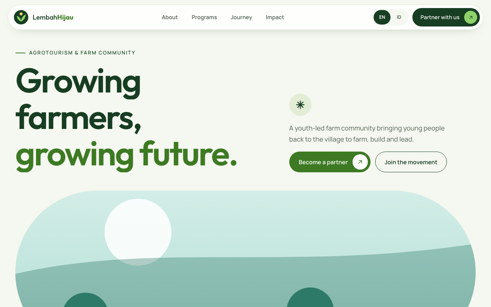

# Template Agrowisata & Komunitas Tani

Template website premium untuk agrowisata, kebun, dan komunitas tani: gaya bento, dua bahasa EN/ID, akordion program, animasi GSAP.

Tier: **premium** · Kategori: Template Website



## Fitur

- Gaya agri bento modern
- Dua bahasa EN/ID satu klik
- Hero kapsul dengan chip angka
- Akordion program ganti gambar
- Linimasa perjalanan geser
- Bagian SDGs & ESG
- Galeri + pita mitra berjalan
- Ilustrasi SVG buatan sendiri
- Aman tanpa JS & reduced-motion

## Cara menjalankan

1. Unduh atau clone folder ini.
2. Klik dua kali `index.html` — langsung terbuka di browser (butuh internet untuk font & GSAP dari CDN).
3. Edit teks dengan editor apa pun (mis. VS Code), simpan, lalu muat ulang browser.
4. Untuk online: unggah seluruh folder ke GitHub Pages, Netlify, atau Vercel.

## Struktur folder

```
index.html   halaman utama (teks Inggris)
app.js       terjemahan Indonesia (objek ID) + animasi
style.css    tampilan & warna (:root)
img/         ilustrasi SVG pengganti foto
meta.json, README.md, LICENSE, ss.png
```

## Cara ubah brand & warna

Teks bahasa Inggris ada di `index.html`, terjemahan Indonesia di objek `ID` di awal `app.js` (kunci `data-i18n`). Nama brand: cari `Lembah` / `Kebun Lembah Hijau`. Kontak (WA 0812-0000-0000, contoh@email.com, @akun.contoh) ada di bagian CTA & footer. Warna di `style.css` `:root`. Gambar: ganti `img/*.svg` dengan foto Anda (nama berkas sama atau ubah `src`).

## Kredit

Dibuat oleh Maliki Studio — malikisaputra.biz.id, follow TikTok/IG @malikisaputra

## Lisensi

MIT — lihat berkas `LICENSE`. Semua nama, kontak, dan angka di template ini **fiktif**; ilustrasi SVG buatan sendiri, silakan ganti dengan foto milik Anda.

---

<!-- kredit-maliki -->
**Kredit:** Template oleh Maliki Saputra (@malikisaputra) — https://malikisaputra.biz.id. Kredit di footer & kepala berkas wajib dipertahankan (lihat LICENSE).
